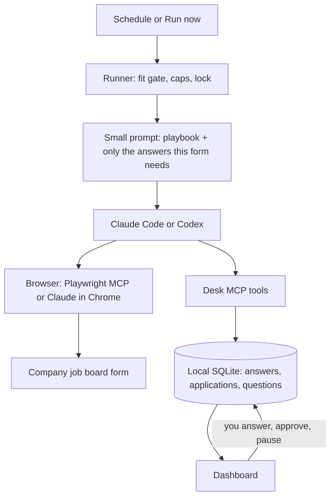

# QuietApply

**A job-application agent that runs on your own machine, applies while you sleep, and asks you before it guesses.**

QuietApply uses the Claude Code or Codex you already have (subscription or API key). It finds roles on company job boards, checks them against your rules, fills in the application in a real browser, and submits it. When a form asks something it doesn't know, it asks you once in a local dashboard and remembers your answer for next time.


> Built from the author's own runner, which has tracked 437 real applications since 16 September 2026. Everything that broke along the way shaped the defaults below.

> **Status: v0.1 in development.** It works end to end in dry-run mode on the bundled fixture pages and has been checked live with Claude Code. Not yet published to npm (the one-line installer builds from GitHub until it is). Expect rough edges.

---

## Why another auto-apply tool?

Most auto-apply bots send as many LinkedIn Easy Apply forms as they can. That gets accounts restricted and annoys recruiters. QuietApply goes the other way:

- **Asks before it guesses.** An answer it doesn't know goes to a question queue; it never makes one up. Every value it types must cite a stored answer, and the submit step refuses anything that doesn't.
- **Applies on company job boards, not LinkedIn.** It finds openings through the public Greenhouse, Lever and Ashby job APIs (no scraping, no login) and applies on the company's own form.
- **Uses the AI you already pay for.** Claude Code (Pro/Max or an API key) or OpenAI Codex (ChatGPT plan or an API key).
- **Remembers without bloating.** Answers are stored as small structured entries. Each run gets only the ones the form in front of it needs, so the prompt stays small no matter how much it has learned.
- **Hands back what it can't do.** CAPTCHAs, video answers, tests, email-only postings and account sign-ups go to a "Finish yourself" list. It never tries to solve a CAPTCHA.
- **Local and private.** Your data stays in `~/.quietapply` (readable only by you). No account, no server, no telemetry.

## Features

- **Guided setup** (`quietapply init`): seven short steps, resumable if you quit halfway. It checks your AI is signed in, reads your resume (PDF, DOCX or text) into a profile you confirm, takes the answers almost every form asks (work authorisation and sponsorship per country, notice period, salary with currency, relocation, remote/hybrid, travel, diversity questions declined by default), your targets, and picks companies for you. Everything is editable later in Settings and Memory.
- **Starter company list:** 249 companies hiring on Greenhouse, Lever and Ashby (94 in India, 192 with remote roles, plus the US and Europe), checked live against their public job APIs. Setup picks the ones that match your roles and places; add any other company by pasting its careers-page link. No board tokens to look up.
- **Answer memory** you can see and edit. Each answer can apply everywhere or to one company only.
- **Fit gate** before every application: job titles, excluded words, locations, never-apply list, years of experience, skill match, and postings that ask for no AI.
- **Job sites:** Greenhouse, Lever and Ashby in v0.1; Workday is next.
- **Local dashboard** at `http://127.0.0.1:4777`: Today, Applications (with every value the agent typed and where it came from), Questions, Finish yourself, Memory, Runs, Settings, plus Run now and Pause. Works on a phone.
- **Review mode:** the first 10 applications stop before Submit and wait for your OK in the dashboard.
- **Dry run by default:** nothing is submitted until you turn dry run off.
- **Duplicate protection:** an application is marked "submitting" before Submit is clicked, so an unclear result is never resent blindly.
- **Caps:** 15 a day and 2 per company per 30 days by default.
- **Scheduler:** launchd (macOS) or a systemd user timer (Linux). Missed runs are coalesced into one; a failed run is retried once; a lock stops overlapping runs; usage limits are waited out.

| Questions | Application detail | On a phone |
|---|---|---|
|  |  |  |

## Quickstart

You need Node.js 22.13 or newer, Google Chrome or Microsoft Edge, and Claude Code or Codex. The installer checks all three and tells you how to get what is missing.

**macOS or Linux, one line:**

```bash
curl -fsSL https://raw.githubusercontent.com/Pvk1294/quietapply/main/install.sh | bash
```

It installs QuietApply into `~/.local/share/quietapply` (no `sudo`; your global npm is untouched), puts the `quietapply` command in `~/.local/bin`, and starts the setup wizard. Add `-s -- --no-init` to only install, or `--dry-run` to see what it would do. Windows (PowerShell): `irm https://raw.githubusercontent.com/Pvk1294/quietapply/main/install.ps1 | iex`.

**Or with npm** (once the package is published):

```bash
npx quietapply init
```

**Try it first with fake data** (nothing leaves your machine, no AI needed): `quietapply demo`.

### What setup asks

`quietapply init` walks through seven steps. Quit any time: finished steps are saved and the next `quietapply init` continues where you stopped. Redo one part with `quietapply init --step <name>`.

1. **AI** (`ai`): finds Claude Code or Codex, checks you are signed in (plan or API key), and shows how to sign in if not.
2. **Resume** (`resume`): reads your resume and pre-fills name, email, phone, city and country, LinkedIn, GitHub, portfolio, work history, education, skills and years of experience for you to confirm or fix.
3. **Standard answers** (`answers`): work authorisation and visa sponsorship for each country you target, notice period, current and expected salary with currency, relocation, remote/hybrid/on-site, travel, "how did you hear about us", diversity questions ("I prefer not to answer" by default) and a cover-letter style.
4. **Targets** (`targets`): job titles, seniority, cities and countries, remote, minimum salary, industries and company sizes you like, companies to never apply to, daily cap.
5. **Where to apply** (`sources`): Greenhouse, Lever and Ashby (LinkedIn stays off; see below), and companies from the starter list or any careers-page link you paste.
6. **Logins** (`logins`): none needed. Greenhouse, Lever and Ashby forms need no account, QuietApply uses its own Chrome profile (`~/.quietapply/browser-profile`), never your everyday browser, and it never asks for or stores passwords.
7. **Safety** (`safety`): dry run stays on, the first 10 applications wait for your OK, then a `quietapply doctor` check and an offer to turn on the schedule.

### Everyday commands

```bash
quietapply dashboard                  # http://127.0.0.1:4777: questions, applications, Memory, Settings
quietapply discover                   # find open roles at your companies (or the best starter-list matches)
quietapply run                        # one run now (dry run: forms are filled, nothing is submitted)
quietapply companies suggest --add    # add the best starter-list matches to your watch list
quietapply companies add <url>        # add a company by careers-page link
quietapply doctor                     # checks the CLI, sign-in, browser and data folder
quietapply schedule on                # runs at the times in config.yaml
```

The first runs open a separate Chrome profile in `~/.quietapply/browser-profile`. Your everyday browser is not touched.

### From source

```bash
git clone https://github.com/Pvk1294/quietapply && cd quietapply
npm install && npm run build
node dist/cli/index.js demo          # fake persona "Jane Doe", fixture pages, dashboard on :4777
npm link                             # makes the `quietapply` command available
quietapply init
```

## How it works



1. **Find:** pulls openings from your company list through the public Greenhouse, Lever and Ashby APIs.
2. **Filter:** checks each role against your rules and logs why it skipped the ones it skipped.
3. **Apply:** the agent opens the form and fills it from your profile and answer memory. Every value has to cite a memory id.
4. **Ask:** an unknown required question becomes a card in the dashboard, and that application waits for the next run.
5. **Record:** dry run, review, submitted, or handed to you; the dashboard shows exactly what was typed.

The agent can only read and change your data through a small set of MCP tools (`lookup_answers`, `ask_human`, `start_submit`, `record_result`, `mark_blocked`…). The setup is the same whichever AI you use, the rules are enforced in code rather than in a prompt, and you can audit every step. More detail: [docs/how-it-works.md](docs/how-it-works.md).

## Providers

| Your AI | Browser it can use | How QuietApply runs it |
|---|---|---|
| Claude Code + Claude plan | Playwright MCP (default) or Claude in Chrome | `claude -p --output-format stream-json --strict-mcp-config …` |
| Claude Code + API key | Playwright MCP (Claude in Chrome needs a Claude plan) | same, with `ANTHROPIC_API_KEY` |
| Codex + ChatGPT plan or API key | Playwright MCP | `codex exec --json` with MCP servers passed as `-c` overrides |

With Claude Code, built-in tools (shell, file editing, web search) are switched off for application runs: the agent has only the browser and the desk tools, and your own settings, hooks and MCP servers are not loaded. Codex runs in its read-only sandbox. The Codex path is built and unit-tested but has not yet been run live.

## Configuration

`~/.quietapply/config.yaml` (also editable in Settings):

```yaml
provider: claude-code          # or codex
auth: subscription             # or api-key
browser: playwright-profile    # or playwright-extension, claude-in-chrome (Claude plans only)
headless: false
dryRun: true                   # nothing is submitted while this is true
schedule: ["09:00", "13:00", "19:00"]
timezone: auto
limits: { perDay: 15, perCompany30d: 2, reviewFirst: 10, runTimeoutMinutes: 30 }
sources: { greenhouse: true, lever: true, ashby: true, linkedin: false }
companies:
  - { name: Acme Rockets, ats: greenhouse, token: acmerockets }
rules:
  roles: [engineer, developer]
  seniority: [mid, senior]          # intern, entry, mid, senior, staff, lead, director
  excludeTitles: [intern, principal]
  countries: [India]                # a job in Bengaluru counts as India
  locations: [remote, Bengaluru]
  minSalary: { amount: 2500000, currency: INR }
  neverApply: [My Current Employer]
preferences: { industries: [fintech, devtools], sizes: [scaleup] }
coverLetterStyle: short             # short, warm, formal, template, none
```

## Safety, and job-site terms of service

- **It never solves CAPTCHAs, sends emails or messages, creates accounts or invents facts.** Those go to you.
- **LinkedIn is off by default and not automated in v0.1.** LinkedIn's [User Agreement](https://www.linkedin.com/legal/user-agreement) (section 8.2) forbids bots and automated access, and LinkedIn [restricts accounts](https://www.linkedin.com/help/linkedin/answer/a1341387) that use them. A future opt-in will require a typed acknowledgment and a low cap. The risk would be yours.
- **Other sites have terms too.** You are responsible for using this within each site's terms and the law where you live.
- **Postings that ask for no AI tools are skipped.**
- **Job pages are untrusted input.** The agent is told to ignore instructions on pages, and the rules that matter (no submit in dry run or review, caps, no invented answers, submit once) are enforced by the desk tools, not by the prompt.
- **Quality over volume.** The defaults are deliberately low. A few well-matched applications get more replies than hundreds of generic ones, and they don't waste recruiters' time.
- **You are the applicant.** Everything it submits is in your name. Keep review mode on until you trust it.

## Roadmap

- **v0.1 (now):** Greenhouse, Lever, Ashby; Claude Code and Codex; dashboard and question queue; answer memory; scheduler; dry run and review mode
- **v0.2:** Workday (accounts you create, optional OS keychain), reply tracking from your inbox (read-only), drafts for email-only postings, Windows, screenshot evidence in the dashboard
- **v0.3:** optional LinkedIn with acknowledgment, company watchlist, phone notifications, more ATSs (SmartRecruiters, Workable, Recruitee) and regional job boards

## Contributing

Site playbooks (`playbooks/*.md`) and ATS adapters (`src/sources/`) are the easiest places to start. Tests run against saved pages in `fixtures/` with a fake persona; never commit real personal data. See [CONTRIBUTING.md](CONTRIBUTING.md) and [SECURITY.md](SECURITY.md).

```bash
npm install
npm run check      # lint + typecheck + tests
npm run build
npm run companies:verify   # re-check the starter company list against the live job APIs
```

Releasing to npm: [docs/RELEASING.md](docs/RELEASING.md).

## License

[MIT](LICENSE)

---

Built by [Prateek Verma](https://github.com/Pvk1294).
