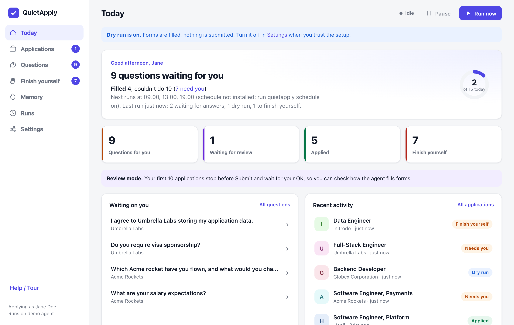
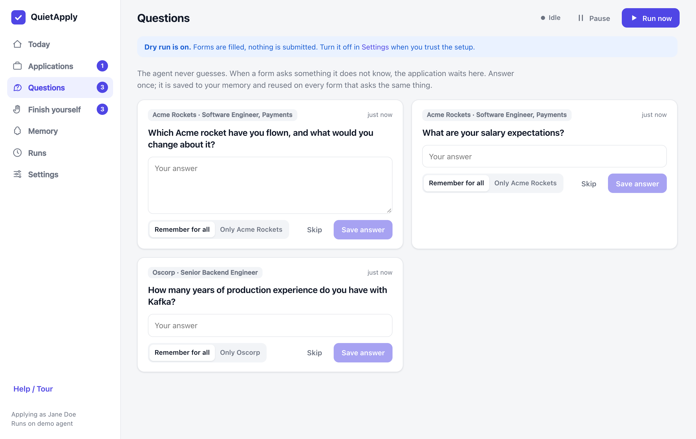
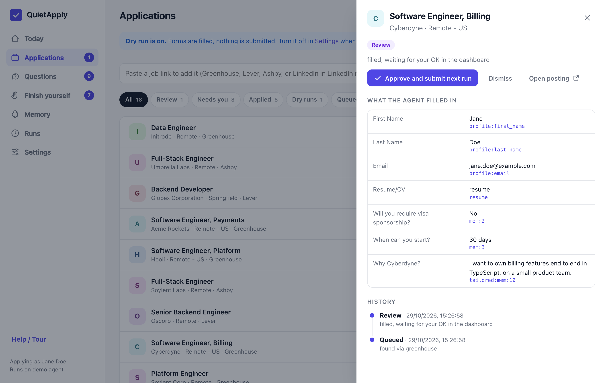
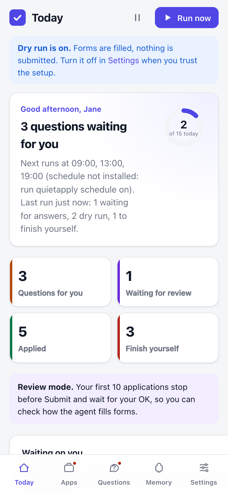
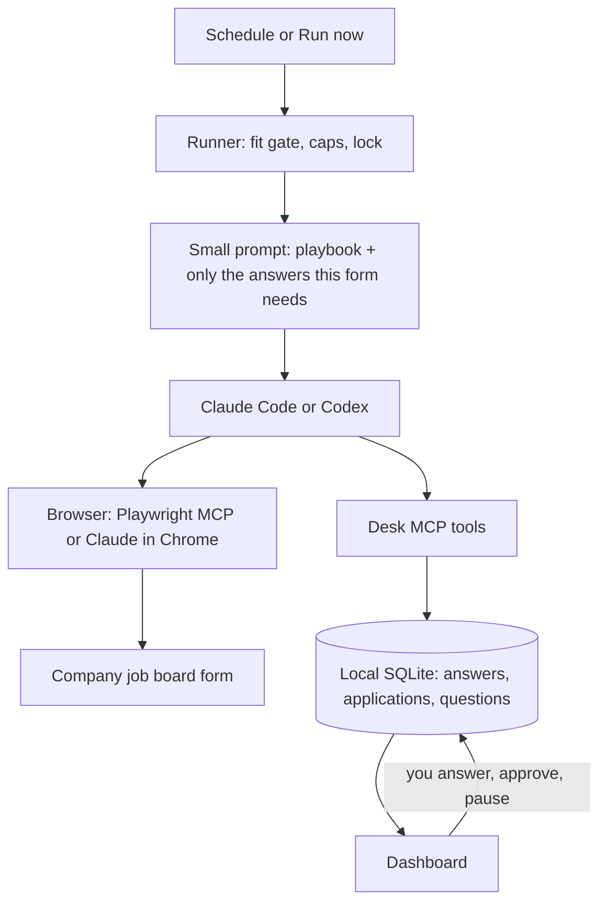

# QuietApply

**A job-application agent that runs on your own machine, applies on company job boards, and asks you before it guesses.**

QuietApply uses the Claude Code or Codex you already have (subscription or API key). It finds roles on company job boards, checks them against your rules, fills in the application in a real browser, and submits it. When a form asks something it doesn't know, it asks you once in a local dashboard and remembers your answer for next time.



> Built from a personal runner that has tracked 437 real applications since 16 September 2026. What broke along the way shaped the defaults below.

> **Status: v0.1, early. Expect rough edges.** What has actually been tested:
> - **Claude Code:** one real application submitted end to end (Ashby, review mode, Playwright browser), and dry runs on real Greenhouse, Lever and Ashby forms.
> - **Codex:** one dry run on the bundled Lever fixture (Codex CLI 0.165, signed in with ChatGPT). No real job yet.
> - **macOS only.** The scheduler (`schedule on`) is unit-tested but has not been run for real on macOS (launchd) or Linux (systemd). Linux and Windows are untested.
> - **Not on npm yet.** Install from a clone, as below. `npx quietapply` does not work.

---

**New here? Start with the friendly guide: [Getting started in 10 minutes](docs/tutorial.md).** The dashboard also opens a short step-by-step tour the first time (reopen it from **Help / Tour**).

## Why another auto-apply tool?

Most auto-apply bots send as many LinkedIn Easy Apply forms as they can. That gets accounts restricted and annoys recruiters. QuietApply goes the other way:

- **Asks before it guesses.** An answer it doesn't know goes to a question queue; it never makes one up. Every value it types must cite a stored answer, and the submit step refuses anything that doesn't.
- **Applies on company job boards by default.** (LinkedIn is an opt-in mode with a risk; see [below](#linkedin-mode-opt-in-and-risky).) It finds openings through the public Greenhouse, Lever and Ashby job APIs (no scraping, no login) and applies on the company's own form.
- **Uses the AI you already pay for.** Claude Code (Pro/Max or an API key) or OpenAI Codex (ChatGPT plan or an API key).
- **Remembers without bloating.** Answers are stored as small structured entries. Each run gets only the ones the form in front of it needs, so the prompt stays small no matter how much it has learned.
- **Hands back what it can't do.** CAPTCHAs, video answers, tests, email-only postings and account sign-ups go to a "Finish yourself" list. It never tries to solve a CAPTCHA.
- **Local and private.** Your data stays in `~/.quietapply` (readable only by you). No account, no server, no telemetry.

## Features

- `quietapply init` reads your resume (PDF, DOCX or text), builds `profile.yaml`, and asks the handful of questions almost every form asks (work authorization, sponsorship, notice period, salary, relocation, consent). Anything you skip is asked later, only when a form needs it.
- **Answer memory** you can see and edit. Each answer can apply everywhere or to one company only.
- **Fit gate** before every application: job titles, excluded words, locations (`remote` means remote roles open in the country you live in), never-apply list, years of experience, skill match, and postings that ask for no AI.
- **Job sites:** Greenhouse, Lever and Ashby in v0.1; Workday is next.
- **Local dashboard** at `http://127.0.0.1:4777`: Today, Applications (with every value the agent typed and where it came from), Questions, Finish yourself, Memory, Runs, Settings, plus Run now and Pause. Works on a phone: `quietapply phone` shares it over your private Tailscale network, nothing public ([docs/phone.md](docs/phone.md)).
- **A reason for everything it skips.** Every job it could not apply to (CAPTCHA, login, a question it cannot answer, a file upload problem, an unsupported site, an outside redirect, your own rules, limits, form errors) is listed under *Finish yourself* with the reason, what is needed, the values to copy, and *I applied myself* / *Not interested* / *Retry* buttons.
- **Review mode:** the first 10 applications stop before Submit and wait for your OK in the dashboard.
- **Dry run by default:** nothing is submitted until you turn dry run off. In dry run the browser itself blocks every request that would send data (form posts, uploads, autosave), so even a stray click on Submit goes nowhere.
- **Screenshots:** the agent screenshots the form at the end of every run, and each application's page in the dashboard shows them next to what was typed.
- **Duplicate protection:** an application is marked "submitting" before Submit is clicked, so an unclear result is never resent blindly.
- **Caps:** 15 a day and 2 per company per 30 days by default.
- **Scheduler:** launchd (macOS) or a systemd user timer (Linux). Missed runs are coalesced into one; a failed run is retried once; a lock stops overlapping runs; usage limits are waited out. (Unit-tested, not yet run for real on either.)

| Questions | Application detail | On a phone |
|---|---|---|
|  |  |  |

## Quickstart

There is no npm package yet: you clone the repo and build it. You need Node.js 22.13 or newer, Google Chrome or Microsoft Edge, and one of:

- [Claude Code](https://code.claude.com/docs) signed in with a Claude plan, or with `ANTHROPIC_API_KEY`
- [Codex CLI](https://github.com/openai/codex) signed in with ChatGPT, or with `CODEX_API_KEY`

**Try it first with fake data** (nothing leaves your machine, no AI needed):

```bash
git clone https://github.com/Pvk1294/quietapply && cd quietapply
npm install && npm run build
node dist/cli/index.js demo          # fake persona "Jane Doe", fixture pages, dashboard on :4777
```

Port 4777 taken? Use `node dist/cli/index.js demo --port 4790`.

**Set it up for yourself:**

```bash
npm link                              # makes the `quietapply` command available (or use node dist/cli/index.js)
quietapply init                       # AI, resume -> profile, city, common questions, job titles, companies
quietapply doctor                     # checks the CLI, login, browser, data folder and what setup still lacks
quietapply discover                   # finds open roles at your companies that pass your rules
quietapply add <job-url>              # or queue one job; title and company come from the job site's API
quietapply run --max 1                # one application now, in dry run: the form is filled, nothing is submitted
quietapply dashboard                  # http://127.0.0.1:4777
quietapply phone                      # optional: the same dashboard on your phone, over Tailscale (docs/phone.md)
quietapply schedule on                # runs at the times in config.yaml
```

The first runs open a separate Chrome profile in `~/.quietapply/browser-profile`. Your everyday browser is not touched.

A few things worth knowing before the first run:

- **Start with `--max 1`.** A plain `quietapply run` works through the whole queue, up to your daily limit (15), and each application is one agent session on your plan.
- **Expect questions at first.** Most real forms ask something setup did not cover (an essay, a clearance, "have you worked here before?"). Those forms wait on the Questions page until you answer, then go through on a later run.
- **`npm link` and permissions.** If it fails with a permission error, your Node install puts global commands in a system folder. Use `node dist/cli/index.js` instead of `quietapply`, or a Node version manager such as nvm or fnm.
- **On macOS, keep the clone out of Desktop, Documents and Downloads** if you want the scheduler. macOS blocks background jobs from reading those folders, and a scheduled run then hangs. `doctor` warns about it.

## How it works



1. **Find:** pulls openings from your company list through the public Greenhouse, Lever and Ashby APIs.
2. **Filter:** checks each role against your rules and logs why it skipped the ones it skipped.
3. **Apply:** the agent opens the form and fills it from your profile and answer memory. Every value has to cite a memory id.
4. **Ask:** an unknown required question becomes a card in the dashboard, and that application waits for the next run.
5. **Record:** dry run, review, submitted, or handed to you; the dashboard shows exactly what was typed, with a screenshot of the form.

The agent can only read and change your data through a small set of MCP tools (`lookup_answers`, `ask_human`, `start_submit`, `record_result`, `mark_blocked`…). The setup is the same whichever AI you use, the rules are enforced in code rather than in a prompt, and you can audit every step. More detail: [docs/how-it-works.md](docs/how-it-works.md).

## LinkedIn mode (opt-in, and risky)

LinkedIn's [User Agreement](https://www.linkedin.com/legal/user-agreement) forbids bots and automated access, and LinkedIn [restricts accounts](https://www.linkedin.com/help/linkedin/answer/a1341387) it believes are automated. **If you turn this mode on, you take that risk for your own account**, even with the small cap and human-like pacing below. QuietApply cannot undo a restriction. It is off by default, and everything else works without it.

If you choose it, QuietApply works the way a careful person would, in **your own logged-in Chrome** through [Claude in Chrome](https://claude.com/chrome) (Claude Code with a Claude plan; not an API key, not Codex):

- applies to LinkedIn jobs you add by link, Easy Apply included; "Apply on company website" leads to Greenhouse, Lever or Ashby and the normal flow
- random pauses of a few seconds, long answers typed in chunks; no scraping, no scripts, no calls to LinkedIn's APIs (the script and network tools are denied to the agent)
- its own daily cap: **5 by default, at most 15**
- **stops at once** on any warning, limit message or CAPTCHA; that job goes to "Finish yourself" and LinkedIn stays stopped until you resume it
- same answer memory and question queue; unknown answers are asked, never guessed
- turning it on needs a confirm step with the risk in plain words; the time you accepted is stored in `config.yaml` (`linkedin.acceptedAt`)

Turn it on in **Settings → LinkedIn mode**, or answer yes to the optional question in `quietapply init`. Details: [tutorial](docs/tutorial.md#linkedin-mode-optional). Tests use made-up pages in `fixtures/linkedin`; nothing in the repo ever touches real LinkedIn.

## Providers

| Your AI | Browser it can use | How QuietApply runs it |
|---|---|---|
| Claude Code + Claude plan | Playwright MCP (default) or Claude in Chrome | `claude -p --output-format stream-json --strict-mcp-config …` |
| Claude Code + API key | Playwright MCP (Claude in Chrome needs a Claude plan) | same, with `ANTHROPIC_API_KEY` |
| Codex + ChatGPT plan or API key | Playwright MCP | `codex exec --json` with MCP servers passed as `-c` overrides |

With Claude Code, built-in tools (shell, file editing, web search) are switched off for application runs: the agent has only the browser and the desk tools, and your own settings, hooks and MCP servers are not loaded. Codex runs in its read-only sandbox, without your own `~/.codex/config.toml`. QuietApply finds the Codex CLI on your PATH, then inside the ChatGPT / Codex desktop app on macOS; set `codex.path` in `config.yaml` to point at one yourself. A live dry run of the Codex path on the bundled Lever fixture worked (Codex CLI 0.165, signed in with ChatGPT). Codex has not been tried on a real job yet.

## Configuration

`~/.quietapply/config.yaml` (also editable in Settings):

```yaml
provider: claude-code          # or codex
auth: subscription             # or api-key
browser: playwright-profile    # or playwright-extension, claude-in-chrome (Claude plans only)
headless: false
dryRun: true                   # nothing is submitted while this is true
schedule: ["09:00", "13:00", "19:00"]
timezone: auto
limits: { perDay: 15, perCompany30d: 2, reviewFirst: 10, runTimeoutMinutes: 30 }
sources: { greenhouse: true, lever: true, ashby: true, linkedin: false }   # linkedin: opt-in, see above
linkedin: { perDay: 5 }        # 1 to 15; acceptedAt is stored when you accept the risk
codex: { path: /Applications/ChatGPT.app/Contents/Resources/codex-cli/bin/codex }   # optional; found automatically
phone: { allowedLogins: [you@example.com] }   # set by `quietapply phone`; see docs/phone.md
companies:
  - { name: Acme Rockets, ats: greenhouse, token: acmerockets }
rules:
  roles: [engineer, developer]
  excludeTitles: [intern, principal]
  locations: [remote, Berlin]
  neverApply: [My Current Employer]
```

## Safety, and job-site terms of service

- **It never solves CAPTCHAs, sends emails or messages, creates accounts or invents facts.** Those go to you.
- **LinkedIn is off by default.** It is an opt-in mode with real risk: see [LinkedIn mode](#linkedin-mode-opt-in-and-risky).
- **Other sites have terms too.** You are responsible for using this within each site's terms and the law where you live.
- **Postings that ask for no AI tools are skipped.**
- **Job pages are untrusted input.** The agent is told to ignore instructions on pages, and the rules that matter (no submit in dry run or review, caps, no invented answers, submit once) are enforced by the desk tools, not by the prompt.
- **Dry run is enforced in the browser too.** With Playwright, dry run loads a network guard that aborts every non-read request before it leaves your machine. Some job sites save what you type as you type (Ashby) or upload the resume the moment it is attached (Greenhouse); the guard stops that too.
- **Use Playwright for dry runs, not Claude in Chrome.** Claude in Chrome drives your own browser, so there is no network guard. It has a tool-level guard instead (no page scripts, no Enter key, and no clicks after the desk refuses the submit step), but that guard cannot read button labels: a click on Submit *before* the agent asks the desk for permission would not be caught. The agent is told never to do that, but that is a prompt rule, not a code rule. Details: [what protects each mode](docs/how-it-works.md#what-protects-each-mode).
- **Quality over volume.** The defaults are deliberately low. A few well-matched applications get more replies than hundreds of generic ones, and they don't waste recruiters' time.
- **You are the applicant.** Everything it submits is in your name. Keep review mode on until you trust it.

## Roadmap

- **v0.1 (now):** Greenhouse, Lever, Ashby; Claude Code and Codex; dashboard and question queue; answer memory; scheduler; dry run and review mode
- **v0.2:** Workday (accounts you create, optional OS keychain), reply tracking from your inbox (read-only), drafts for email-only postings, Windows
- **v0.3:** company watchlist, phone notifications, more ATSs (SmartRecruiters, Workable, Recruitee) and regional job boards

## Contributing

Site playbooks (`playbooks/*.md`) and ATS adapters (`src/sources/`) are the easiest places to start. Tests run against saved pages in `fixtures/` with a fake persona; never commit real personal data. See [CONTRIBUTING.md](CONTRIBUTING.md) and [SECURITY.md](SECURITY.md).

```bash
npm install
npm run build
npm run check      # lint + typecheck + tests (a few read the built dashboard, so build first)
```

## License

[MIT](LICENSE)

---

Built by [Prateek Verma](https://github.com/Pvk1294).
