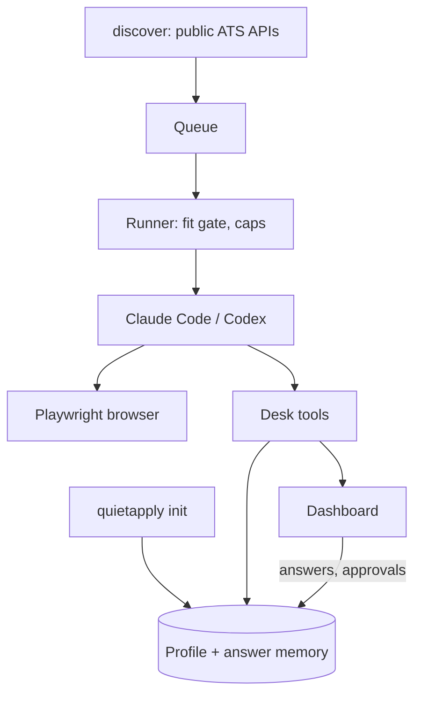

# QuietApply: night 1 report (26 Oct 2026)

**Summary**
1. QuietApply v0.1 works end to end in dry-run mode: setup from a resume, answer memory, question queue, runner, Greenhouse/Lever/Ashby, dashboard, scheduler. It never submits while dry run is on.
2. Checked live once: your Claude Code (Sonnet) with Playwright MCP filled the Lever fixture page on localhost. It cited a memory id for every field and stopped before Submit ([script](../scripts/live-dry-run.mjs)).
3. Checks pass on a fresh clone: lint, types, build and 78 tests.
4. Private repo created: [github.com/Pvk1294/quietapply](https://github.com/Pvk1294/quietapply), branch `v0.1-night1`. **The last 5 commits are local only:** Dot's checker sent the push to you for approval. Until you push, the GitHub copy cannot build, because `src/resume/` is missing there.
5. No real application, email or post was sent. None of your data or your old code was copied or changed.

## What works
- **Repo:** TypeScript, Biome lint, Vitest, MIT license. CI runs lint, types, build and tests on Node 22 and 24 (Linux and macOS), plus a gitleaks secret scan ([ci.yml](../.github/workflows/ci.yml)). The `.gitignore` keeps user data out.
- **Data:** everything is in `~/.quietapply` (folder mode 700): `config.yaml`, `profile.yaml`, and SQLite `data.db` using Node's built-in `node:sqlite`, so there is nothing native to compile ([db.ts](../src/core/db.ts)).
- **Answer memory:** structured entries instead of one growing prompt. Each entry has a key, other wordings and a scope (everywhere / one company / one ATS). Lookup returns *known* (with an id), *maybe* or *unknown*, and never guesses ([answers.ts](../src/memory/answers.ts)). There are 25 standard questions with the wordings forms use ([seed.ts](../src/memory/seed.ts)).
- **`quietapply init`:**
  - finds Claude Code and Codex, and lets you choose the provider and browser
  - reads a PDF, DOCX or text resume; a rule-based parser runs first and your own agent improves it
  - asks only the essential questions; anything skipped is asked later, when a form needs it ([init.ts](../src/cli/init.ts))
- **Desk MCP server:** the agent's only way to read or change your data.
  - `start_submit` refuses any value without a valid memory id.
  - It decides dry run / review / limits in code, and marks the application "submitting" before the click, so an unclear result is never resent ([desk.ts](../src/mcp/desk.ts)).
- **Providers:**
  - Claude Code: `claude -p` with a strict MCP config. Only the desk and browser tools are allowed, and your own settings are not loaded.
  - Codex: `codex exec --json`, with the MCP servers passed as `-c` overrides.
  - Both recognise usage-limit messages ([providers/](../src/providers)).
- **Runner:** pause flag, lock, fit gate (titles, locations, never-apply list, years, skills, "no AI" postings), 15 per day, 2 per company per 30 days, review mode for the first 10. The prompt is small (a few KB): it carries only the answers that this form needs ([run.ts](../src/runner/run.ts), [prompt.ts](../src/runner/prompt.ts)).
- **ATS:**
  - Jobs are found through the public APIs (no scraping): [Greenhouse](https://developers.greenhouse.io/job-board.html), [Lever](https://github.com/lever/postings-api), [Ashby](https://developers.ashbyhq.com/docs/public-job-posting-api).
  - A form parser reads labels, types, required flags and options, and spots CAPTCHAs.
  - Tested on fixture pages for made-up companies ([fixtures/ats](../fixtures/ats)).
  - I checked the live API shapes with read-only requests tonight. Greenhouse also returns an AI-disclaimer field, which the fit gate now reads.
- **Dashboard:**
  - pages: Today, Applications (each value typed and its memory id), Questions (answer once; remember for all or for one company), Finish yourself, Memory, Runs, Settings
  - Run now and Pause buttons; works on desktop and phone, light and dark
  - listens on 127.0.0.1 only, with host and CSRF checks
  - screenshots in [docs/screenshots](screenshots)
- **Scheduler:** launchd / systemd user timer calling `quietapply tick` every 15 minutes. Missed runs are merged into one, a failed run gets one retry, and the logic comes from your runner ([scheduler/](../src/scheduler)). I did not install it on your Mac.
- **Docs:** [README](../README.md), [CONTRIBUTING](../CONTRIBUTING.md), [SECURITY](../SECURITY.md), [how it works](how-it-works.md).



## What is stubbed or not done
- **Codex has not been run live.** It is not installed on this Mac. The command line is unit-tested, and the `-c mcp_servers…` syntax follows the documented config, but it still needs one real run ([Codex docs](https://learn.chatgpt.com/docs/non-interactive-mode)).
- **Live mode (dry run off) has never submitted a real application.** By design, nothing real was tried tonight.
- **Not built yet:**
  - Workday, LinkedIn (off; config only), reply tracking, Windows scheduling
  - npm publishing, so `npx quietapply` does not work yet; for now: clone, then `npm link`
  - screenshot evidence in the dashboard (the agent saves screenshots to `logs/`, but the UI does not show them yet)
- **Not tested end to end:** the interactive `init` flow (its building blocks are tested, and a non-interactive `init --yes` was run).
- **Not wired in:** Claude in Chrome mode is built into the command line but was not tried.

## Try it locally (3 commands)
```bash
cd ~/Desktop/quietapply && npm install && npm run build
node dist/cli/index.js demo        # fake "Jane Doe" data, opens http://127.0.0.1:4777
node scripts/live-dry-run.mjs      # optional: one real dry run with your Claude Code on a local fixture (about 1 min)
```

## Waiting for you
- **Push approval.** Dot's checker stopped a `git add -A` + push after the live run, in case a resume had been staged. I checked: only code changed, and the live run wrote only to temp folders. I committed the named files locally and pushed nothing more. To push: `cd ~/Desktop/quietapply && git push`. This also fixes the remote build, which lacks `src/resume/` because of a `.gitignore` bug that is now fixed.
- **No pull request yet.** The repo has no `main` branch, and pushing to main is not something I'm allowed to do. Create `main` from `v0.1-night1` when you are happy with it.

## Open decisions
- **Name:** QuietApply (npm and GitHub names were free on 26 Oct per the planning report). It is used only in `package.json`, the README and the UI, so it is easy to rename.
- **Stack:** TypeScript, Hono, React + Vite, SQLite through `node:sqlite`. This needs **Node 22.13+**, not the 20+ in the plan; that is the cost of having no native module to compile.
- **Lint:** Biome instead of ESLint (one dependency, fast). Easy to swap.
- **License:** MIT, as in the plan.
- **Defaults:**
  - dry run on, 10 reviews before Submit, 15 a day, 2 per company per 30 days
  - demographic questions default to "I prefer not to answer"
  - "How did you hear about us" defaults to "Company careers page"
  - consent checkboxes are asked once during setup
- **Playwright MCP is pinned to 0.0.83** for reproducible runs. Update it on purpose, not automatically.
- **The live test used Sonnet** to keep usage on your plan low. The provider defaults to your CLI's default model unless you set `model:` in the config.

## Next steps toward v0.1
1. Push, open the repo, and check that CI is green on GitHub.
2. One live Codex dry run (`npm i -g @openai/codex`, then `codex login`).
3. Dogfood in review mode on two or three real Greenhouse jobs, and watch the browser.
4. Show the agent's screenshot on each application in the dashboard.
5. A test for the interactive `init` flow; `quietapply add` should fetch the title from the API.
6. Publish to npm (needs your approval), then record the demo GIF with the fake persona.
