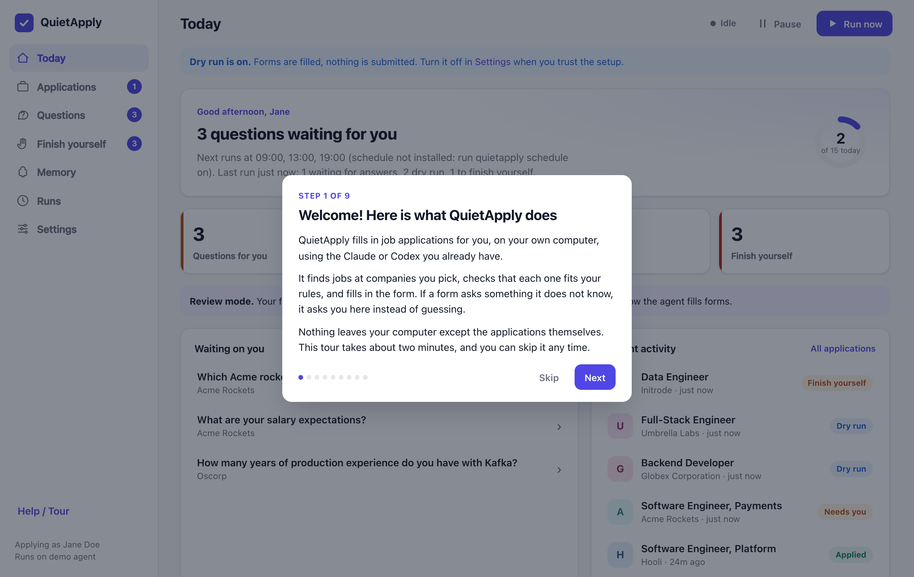
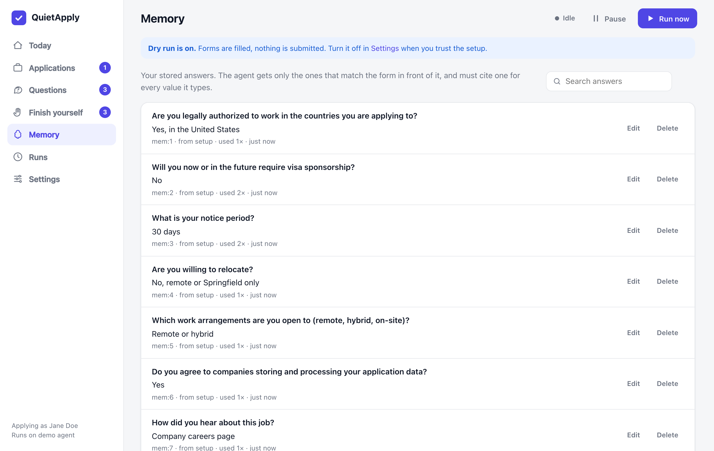
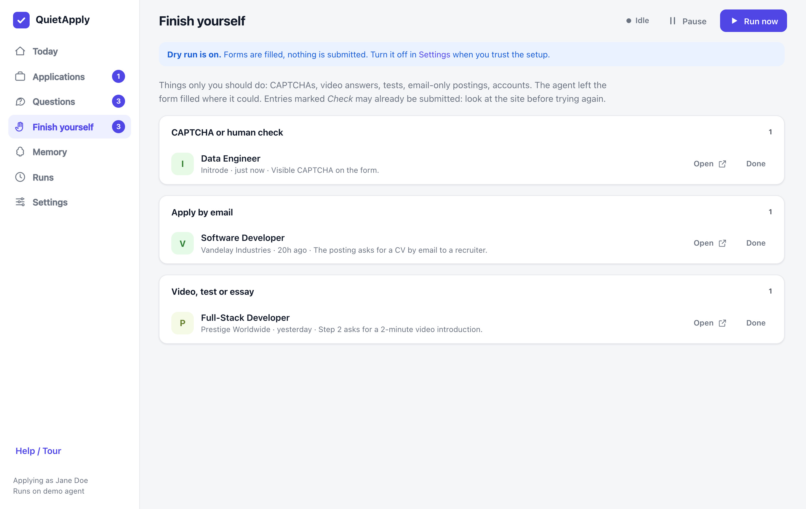
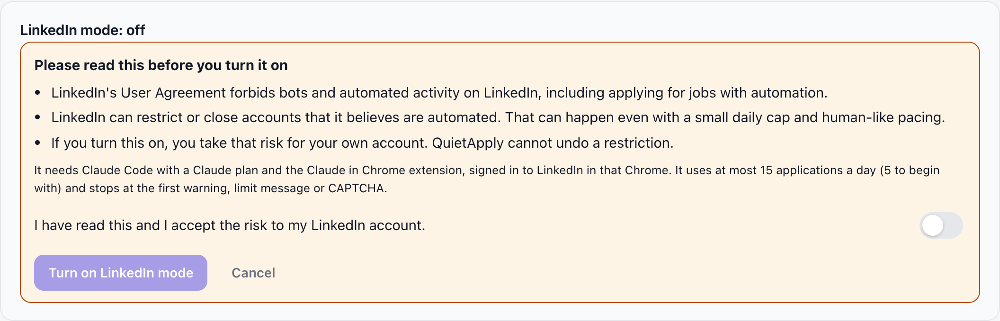

# Getting started in 10 minutes

Hi! This guide walks you through QuietApply from nothing to your first practice application. Take it slowly; nothing here sends a real application, and you can stop at any point. All the screenshots use a made-up person, **Jane Doe**, and made-up companies.

**What you need:** Node.js 22.13 or newer, Google Chrome, and either [Claude Code](https://code.claude.com/docs) or [Codex CLI](https://github.com/openai/codex), signed in. A few minutes. That is all.

## 1. Try it first with fake data (2 minutes)

If you would like to look around before giving it your resume, this is the way. It needs no AI and touches nothing real.

```bash
git clone https://github.com/Pvk1294/quietapply && cd quietapply
npm install && npm run build
node dist/cli/index.js demo          # add --port 4790 if 4777 is taken
```

Open <http://127.0.0.1:4777>. The first time, a short tour pops up and explains each part in plain words. You can skip it and reopen it any time from **Help / Tour** in the sidebar.



The demo is Jane Doe, a fictional engineer. Here is her **Today** page: what needs her, what was applied to, and today's limit.


## 2. Set it up for yourself (3 minutes)

```bash
npm link                 # makes the `quietapply` command available (or use node dist/cli/index.js)
quietapply init          # the friendly setup
```

`init` says what each question is for before it asks it. In order, it:

1. looks for Claude Code and Codex and asks which one to use,
2. reads your resume (PDF, Word or text) and builds your profile,
3. lets you fix your name, email, phone and city,
4. asks the handful of questions nearly every form asks (work authorization, notice period, and so on). **Leave any empty to skip it**; you will be asked later, only when a form needs it,
5. asks which job titles (at least one) and locations you want (`remote` means remote roles open in your country), which companies to never apply to, and which careers pages to watch,
6. asks, as a plain yes/no that defaults to no, whether you want the optional LinkedIn mode (see [below](#linkedin-mode-optional)).

Then check that everything is in place:

```bash
quietapply doctor
```

A tick means good, `!` means worth a look, a cross means fix it first.

## 3. Your first dry run (2 minutes)

```bash
quietapply discover      # finds open jobs at the companies you added
quietapply run --max 1   # one application now (without --max it works through the queue, up to 15 a day)
quietapply dashboard     # http://127.0.0.1:4777
```

**Dry run is on by default.** The agent opens each form and fills it in, but it never presses Submit. Open **Applications** to see exactly what it typed and where each value came from.


Every value cites a saved answer (`mem:12`, `profile:email`, `resume`). If it cannot cite one, it is not allowed to type it.

## 4. Questions: answer once, remembered forever

When a form asks something QuietApply does not know, it does not guess. The application waits on the **Questions** page.


Type your answer, pick **Remember for all** or **Only this company**, and press **Save answer**. That application continues at the next run, and every future form that asks the same thing is filled automatically. See everything it remembers on the **Memory** page, where you can edit or delete any answer.



## 5. Going live, carefully

Once a few dry runs look right, open **Settings** and turn **Dry run** off. Even then:

- the **first 10 applications stop before Submit** and wait for your OK on the Applications page (review mode),
- the daily limit is **15** and each company is limited to **2 per 30 days** by default; lower them if you like.

## 6. "Finish yourself"

Some things only a person should do: CAPTCHAs, video answers, tests, apply-by-email postings, creating an account. QuietApply never tries to get around them. It fills in what it can and lists the job on **Finish yourself**. Each entry is grouped under its reason (a CAPTCHA, a login, a site not supported yet, one of your own rules or limits, a LinkedIn limit or warning), says what is needed, and lists the answers already filled in with a **Copy** button for each. Open the job, finish it, then press **I applied myself**. **Not interested** leaves it alone, and **Retry** queues it again when that makes sense. Entries marked **Unclear** may already have gone through, so look at the site before trying again.



## 7. Let it run on a schedule

```bash
quietapply schedule on    # runs at the times in Settings: 09:00, 13:00, 19:00
quietapply schedule off
```

**Pause** in the top bar stops everything until you press Resume.

## LinkedIn mode (optional)

> **The risk, plainly.** LinkedIn's [User Agreement](https://www.linkedin.com/legal/user-agreement) forbids bots and automated activity. LinkedIn can restrict or close accounts it thinks are automated, even if you keep the numbers small. If you turn this on, that risk is yours. Plenty of people skip it, and that is a good choice: Greenhouse, Lever and Ashby work without it.

LinkedIn mode is **off by default**. If you choose it:

- it drives **your own Chrome, already signed in to LinkedIn**, through the Claude in Chrome extension (so it needs Claude Code with a Claude plan; not an API key, not Codex),
- it applies to LinkedIn jobs, Easy Apply included, and follows "Apply on company website" links to Greenhouse, Lever or Ashby, where the normal flow takes over,
- it acts like a person: random pauses of a few seconds, long answers typed in chunks, and it never runs scripts or calls LinkedIn's internal APIs,
- it has its **own daily limit: 5 by default, at most 15**,
- it **stops at once** on any warning, limit message or CAPTCHA. That job goes to Finish yourself and LinkedIn mode stays stopped until you look at your account and press **Resume LinkedIn**,
- it uses the same answer memory and question queue, and never guesses.

To turn it on, open **Settings → LinkedIn mode → Set up LinkedIn mode**, read the risk, tick that you accept it, and confirm. The time you accepted is stored.



Install the [Claude in Chrome extension](https://claude.com/chrome), sign in to LinkedIn in that Chrome, and add a job by pasting its link into the box on the Applications page (or `quietapply add <linkedin-job-url>`).

## On your phone (optional)

You can open the same dashboard on your phone through [Tailscale](https://tailscale.com), a free private network between your own devices. Nothing is public. It stays inside your own Tailscale network, and only the Tailscale logins you allow can open it.

1. Install Tailscale on the Mac and on your phone, and sign in on both with the same account.
2. In the [Tailscale admin page](https://login.tailscale.com/admin/dns), turn on **MagicDNS** and **HTTPS Certificates**.
3. In the dashboard, open **Settings → Phone access** and press **Turn on phone access** (or run `quietapply phone`). It shows the address to open on your phone, with a Copy button.

Phone access can only be switched on or off on the Mac itself. The quick tour has a step about it too. Setup and the safety details are in [phone.md](phone.md).

## If something goes wrong

| What you see | What to do |
|---|---|
| `quietapply doctor` shows a cross | Read the line; it says what to install or sign in to. |
| Nothing is picked up | Run `quietapply discover`, and check titles and locations in Settings. |
| An application says **Needs you** | Open Questions and answer it. |
| An application says **Unclear** | It may have gone through. Look at the site before retrying. |
| LinkedIn mode says **Stopped** | LinkedIn showed a warning. Look at your account first, then Resume in Settings. |

You can always reopen the in-app tour from **Help / Tour**. More detail on how it works inside: [how-it-works.md](how-it-works.md).
